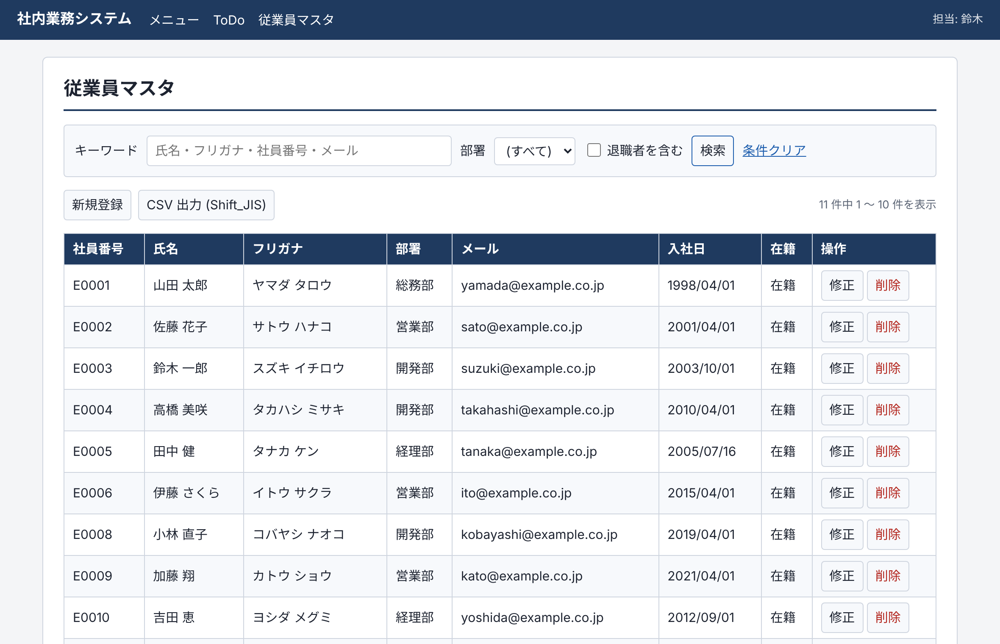
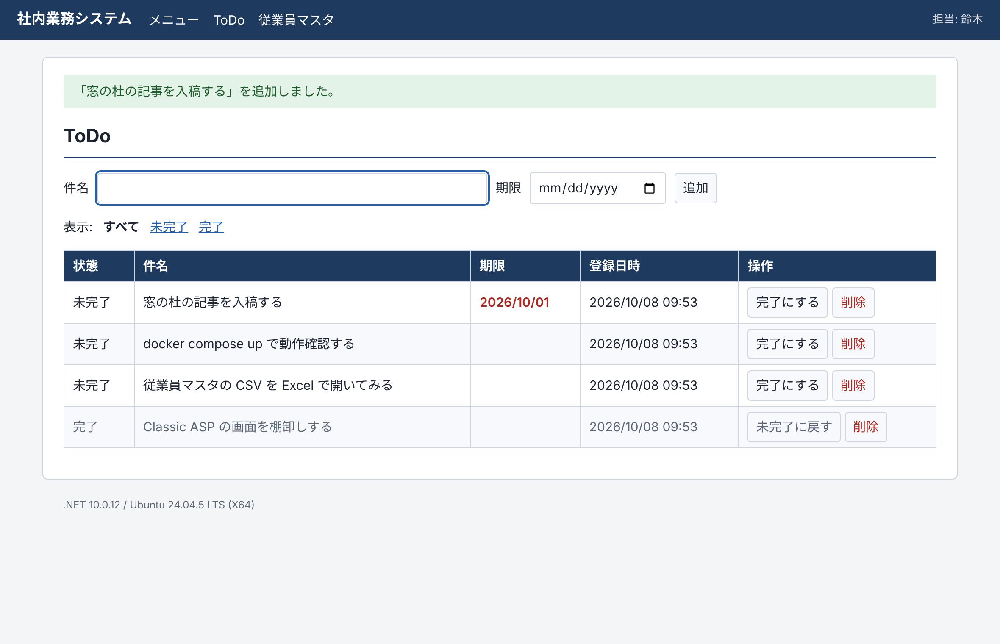
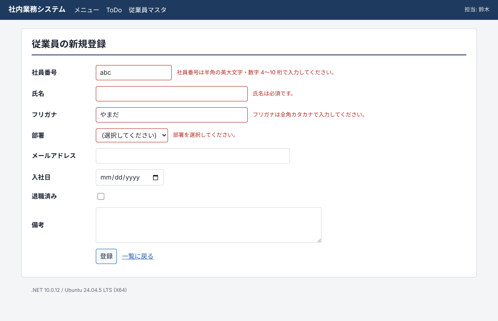

# classic-asp-to-razor

**Classic ASP の書き味のまま、Docker / Linux で動く業務アプリを作る** ― ASP.NET Core Razor Pages のサンプルです。

`todo.asp` や `employees.asp` を書いていた人が、同じ感覚で読めることを目指しています。

- `docker compose up` だけで起動します (Windows も IIS も不要)
- 題材は社内システムの定番、**ToDo** と **従業員マスタ** (検索・ページ送り・登録・修正・削除・CSV 出力)
- 当時風の Classic ASP 版 (`legacy/asp`) と並べて読めます
- Excel でそのまま開ける Shift_JIS の CSV、Session、アクセスカウンターなど「あの頃の定番」を現代の書き方で再現



## すぐ試す

必要なのは Docker だけです。

```bash
git clone <このリポジトリの URL>
cd classic-asp-to-razor
docker compose up --build
```

ブラウザーで <http://localhost:8080> を開きます。終了は `Ctrl+C`、データごと消すなら `docker compose down -v` です。

| 画面 | URL | ソース |
|---|---|---|
| メニュー | <http://localhost:8080/> | `apps/web/Pages/Index.cshtml` |
| ToDo | <http://localhost:8080/Todo> | `apps/web/Pages/Todo.cshtml` |
| 従業員マスタ | <http://localhost:8080/Employees> | `apps/web/Pages/Employees/` |

| ToDo (1 ファイル完結スタイル) | 入力チェック (日本語メッセージ) |
|---|---|
|  |  |

## Razor Pages って何?

「1 ページ = 1 ファイル」で作る、ASP.NET Core 標準の仕組みです。
HTML の中に `@` で C# を埋め込みます。Classic ASP の `<% %>` を知っていれば、すぐ読めます。

**Classic ASP (VBScript)**

```asp
<% Do Until rs.EOF %>
    <tr><td><%= Server.HTMLEncode(rs("title")) %></td></tr>
<%
    rs.MoveNext
Loop
%>
```

**Razor Pages (C#)**

```cshtml
@foreach (var todo in Todos)
{
    <tr><td>@todo.Title</td></tr>
}
```

VBScript は Linux では動かないため (Windows でも非推奨になりました)、言語は C# に変わります。
ただし「ファイルを置けば URL になる」「HTML にコードを埋め込む」という作り方はそのままです。

- くわしい解説: **[docs/razor-pages-primer.md](docs/razor-pages-primer.md)** (Razor Pages とは / なぜ VBScript ではないのか / 仕組み / つまずきやすい点)
- 書き換えの早見表: **[docs/asp-to-razor-cheatsheet.md](docs/asp-to-razor-cheatsheet.md)** (`Request.Form`、`Session`、ADO、BASP21 などの置き換え先)

## 読む順番のおすすめ

1. **`legacy/asp/todo.asp`** ― 当時の書き方を思い出す
2. **`apps/web/Pages/Todo.cshtml`** ― 同じ画面の Razor Pages 版。画面と処理を 1 ファイルに書く、ASP にいちばん近いスタイル
3. **`apps/web/Pages/Employees/`** ― 画面 (`.cshtml`) と処理 (`.cshtml.cs`) を分ける、標準のスタイル
4. **`apps/web/Program.cs`** ― `global.asa` と IIS の設定にあたる部分

ソースのコメントには `ASP: Request.Form("...")` のように、対応する ASP の書き方を添えてあります。

## フォルダー構成

```
.
├── apps/
│   └── web/                  Razor Pages 版のアプリ本体 (ASP.NET Core 10)
│       ├── Pages/            画面。フォルダー構成がそのまま URL になる
│       ├── Data/             テーブル定義 (schema.sql) と SQL をまとめたクラス
│       ├── wwwroot/          CSS などの静的ファイル
│       ├── Program.cs        起動処理
│       └── Dockerfile
├── legacy/
│   └── asp/                  当時風の Classic ASP 版 (読み比べ用。実行はしない)
├── tests/
│   └── WebApp.Tests/         自動テスト (画面を実際に HTTP で操作する)
├── docs/                     解説と早見表
├── docker-compose.yml        アプリ + PostgreSQL
├── AGENTS.md                 AI コーディングエージェント向けの作業ルール
└── ClassicAspToRazor.slnx    ソリューション (Visual Studio / Rider / VS Code で開く)
```

## 使っている技術

| 役割 | 採用したもの | Classic ASP 時代でいうと |
|---|---|---|
| 実行環境 | .NET 10 (LTS) / ASP.NET Core | IIS + ASP |
| 画面 | Razor Pages | `.asp` |
| 言語 | C# | VBScript |
| DB | PostgreSQL 17 | SQL Server / Access |
| DB アクセス | Npgsql + Dapper (SQL は手書き) | ADO (`ADODB.Connection` / `Recordset`) |
| 配布 | Docker (Ubuntu ベースの公式イメージ) | サーバーに直接コピー |

画面の見た目は自前の CSS 1 枚だけで、JavaScript フレームワークは使っていません。

## 開発する

.NET SDK を入れて手元で動かす場合の手順です。SDK 10.0 が必要です。

```bash
# DB だけコンテナで起動する
docker compose up -d db

# アプリを起動する (ソースを保存すると自動で再読み込みされる)
dotnet watch --project apps/web
```

表示された URL (既定では <http://localhost:5121>) を開きます。

### テスト

```bash
docker compose up -d db
dotnet test
```

テストは PostgreSQL に実際に接続します (テスト専用のデータベース `aspdemo_test` を自動で作ります)。
接続先を変える場合は、環境変数 `TEST_CONNECTION_STRING` を指定します。

### 設定

| 設定名 (環境変数での書き方) | 内容 | 既定値 |
|---|---|---|
| `ConnectionStrings__Default` | PostgreSQL の接続文字列 | `Host=localhost;Port=5432;Database=aspdemo;Username=app;Password=app` |
| `DataProtection__KeysPath` | Cookie の暗号鍵を保存するフォルダー | 空 (.NET の既定の場所) |
| `ASPNETCORE_HTTP_PORTS` | 待ち受けるポート (コンテナ内) | `8080` |
| `TZ` | タイムゾーン | `Asia/Tokyo` (compose で指定) |

テーブルと初期データは、アプリの起動時に `apps/web/Data/schema.sql` から自動で作られます。

## 本番で使う前に

これは学習用のサンプルです。実際の業務で使う場合は、少なくとも次の対応が必要です。

- **ログイン機能がありません。** 「担当者名」は自己申告で、誰でも全データを操作できます。
  社内で使う場合も、認証 (ASP.NET Core Identity、Microsoft Entra ID など) を追加してください。
- **DB のパスワードがサンプル用の固定値です。** `docker-compose.yml` の `app` / `app` を必ず変更してください。
- **HTTPS の設定がありません。** リバースプロキシ (nginx、Caddy、クラウドのロードバランサーなど) で HTTPS にしてください。
- **Session とアクセスカウンターはメモリ上にあります。** アプリを再起動すると消えます。複数台構成にはできません。
- **テーブル定義の変更履歴を管理する仕組みがありません。** 列の追加などが必要になったら、マイグレーションツールの導入を検討してください。

## ライセンス

[MIT License](LICENSE)

BASP21 および Classic ASP のコード・バイナリは一切含んでいません。
`legacy/asp` は、このサンプルのために新しく書き起こした参考コードです。
