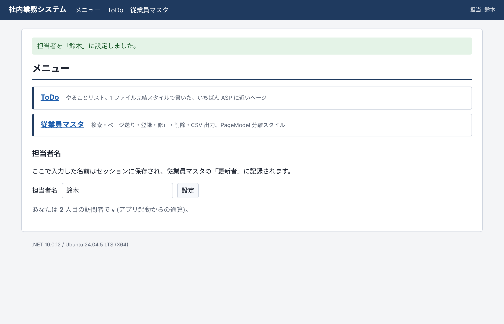

# classic-asp-to-razor

**English** | [日本語](README.ja.md)

**Build line-of-business apps that run on Docker / Linux, written the way you wrote Classic ASP** ― a sample in ASP.NET Core Razor Pages.

It is meant to be readable by people who used to write `todo.asp` and `employees.asp`.

- Starts with `docker compose up` alone (no Windows, no IIS)
- The subjects are the classics of in-house systems: a **ToDo** list and an **employee master** (search, paging, create, edit, delete, CSV export)
- A period-style Classic ASP version (`legacy/asp`) sits next to it so you can read both side by side
- Shift_JIS CSV that opens directly in Excel, Session, an access counter ― the staples of that era, rewritten the modern way

The screens, code comments and the guides under `docs/` are in Japanese, because the sample was written for Japanese readers.


## Quick start

All you need is Docker.

```bash
git clone https://github.com/aicuai/docker-razor-pages.git
cd docker-razor-pages
docker compose up --build
```

Open <http://localhost:8080> in a browser. Stop with `Ctrl+C`. To remove the data as well, run `docker compose down -v`.

| Screen | URL | Source |
|---|---|---|
| Menu | <http://localhost:8080/> | `apps/web/Pages/Index.cshtml` |
| ToDo | <http://localhost:8080/Todo> | `apps/web/Pages/Todo.cshtml` |
| Employee master | <http://localhost:8080/Employees> | `apps/web/Pages/Employees/` |

| ToDo (single-file style) | Input validation (messages in Japanese) |
|---|---|
|  |  |

## Start with `default.asp`

A Classic ASP site usually started at `default.asp`. So does this sample.
The menu screen carries two staples of the time: **Session** (the operator's name) and **Application** (the access counter).



**Classic ASP ― [`legacy/asp/default.asp`](legacy/asp/default.asp)**

```asp
<%
If Request.ServerVariables("REQUEST_METHOD") = "POST" Then
    operatorName = Trim(Request.Form("OperatorName"))
    If operatorName = "" Then
        errMsg = "担当者名を入力してください。"
    Else
        Session("OperatorName") = operatorName
        Response.Redirect "default.asp"
    End If
End If

Application.Lock
Application("Counter") = Application("Counter") + 1
hits = Application("Counter")
Application.Unlock
%>
<p>あなたは <b><%= FormatNumber(hits, 0) %></b> 人目の訪問者です。</p>
```

**Razor Pages ― [`apps/web/Pages/Index.cshtml`](apps/web/Pages/Index.cshtml)**

```cshtml
@page
@inject AccessCounter Counter
@{
    var hits = Counter.Increment();
}
<p>あなたは <strong>@hits.ToString("N0")</strong> 人目の訪問者です。</p>

@functions {
    [BindProperty]
    public string? OperatorName { get; set; }

    public IActionResult OnPost()
    {
        var name = OperatorName?.Trim();
        if (string.IsNullOrEmpty(name))
        {
            ModelState.AddModelError(nameof(OperatorName), "担当者名を入力してください。");
            return Page();
        }

        HttpContext.Session.SetString(SessionKeys.OperatorName, name);
        return RedirectToPage();
    }
}
```

`default.asp` becomes `Index.cshtml`, `Request.Form` becomes `[BindProperty]`, and `Response.Redirect` becomes `RedirectToPage()`.
The screen and its logic still sit together in one file. (Both listings are excerpts; follow the links for the full files.)

## What is Razor Pages?

It is the standard ASP.NET Core way of building a site as "one page = one file".
You embed C# in HTML with `@`. If you know `<% %>` from Classic ASP, you can read it right away.

**Classic ASP (VBScript)**

```asp
<% Do Until rs.EOF %>
    <tr><td><%= Server.HTMLEncode(rs("title")) %></td></tr>
<%
    rs.MoveNext
Loop
%>
```

**Razor Pages (C#)**

```cshtml
@foreach (var todo in Todos)
{
    <tr><td>@todo.Title</td></tr>
}
```

VBScript does not run on Linux (and is deprecated on Windows too), so the language changes to C#.
The way you build things stays the same: put a file in place and it becomes a URL, and you embed code in HTML.

- Full guide (Japanese): **[docs/razor-pages-primer.md](docs/razor-pages-primer.md)** (what Razor Pages is / why not VBScript / how it works / common pitfalls)
- Rewrite cheat sheet (Japanese): **[docs/asp-to-razor-cheatsheet.md](docs/asp-to-razor-cheatsheet.md)** (where `Request.Form`, `Session`, ADO, BASP21 and others go)

## Suggested reading order

1. **`legacy/asp/default.asp`** and **`apps/web/Pages/Index.cshtml`** ― see the difference on the smallest screen
2. **`legacy/asp/todo.asp`** ― recall how it was written back then
3. **`apps/web/Pages/Todo.cshtml`** ― the Razor Pages version of the same screen. Screen and logic in one file, the style closest to ASP
4. **`apps/web/Pages/Employees/`** ― the standard style, with the screen (`.cshtml`) and the logic (`.cshtml.cs`) in separate files
5. **`apps/web/Program.cs`** ― the counterpart of `global.asa` and the IIS settings

Source comments note the matching ASP code, in the form `ASP: Request.Form("...")`.

## Folder layout

```
.
├── apps/
│   └── web/                  The Razor Pages app (ASP.NET Core 10)
│       ├── Pages/            Screens. The folder structure is the URL structure
│       ├── Data/             Table definitions (schema.sql) and the classes that hold the SQL
│       ├── wwwroot/          Static files such as CSS
│       ├── Program.cs        Startup
│       └── Dockerfile
├── legacy/
│   └── asp/                  Period-style Classic ASP version (for reading only; it is not run)
├── tests/
│   └── WebApp.Tests/         Automated tests (they drive the screens over real HTTP)
├── docs/                     Guide and cheat sheet (Japanese)
├── docker-compose.yml        App + PostgreSQL
├── README.md                 This file
├── README.ja.md              Japanese README
├── AGENTS.md                 Working rules for AI coding agents
└── ClassicAspToRazor.slnx    Solution (open in Visual Studio / Rider / VS Code)
```

## Tech stack

| Role | What is used | Classic ASP equivalent |
|---|---|---|
| Runtime | .NET 10 (LTS) / ASP.NET Core | IIS + ASP |
| Screens | Razor Pages | `.asp` |
| Language | C# | VBScript |
| Database | PostgreSQL 17 | SQL Server / Access |
| Data access | Npgsql + Dapper (hand-written SQL) | ADO (`ADODB.Connection` / `Recordset`) |
| Distribution | Docker (official Ubuntu-based images) | Copying files onto the server |

The look of the screens comes from a single hand-written CSS file. No JavaScript framework is used.

## Development

These steps are for running the app locally with the .NET SDK. SDK 10.0 is required.

```bash
# Start only the database in a container
docker compose up -d db

# Start the app (it reloads when you save a source file)
dotnet watch --project apps/web
```

Open the URL that is printed (<http://localhost:5121> by default).

### Tests

```bash
docker compose up -d db
dotnet test
```

The tests connect to a real PostgreSQL (they create a test-only database, `aspdemo_test`, on their own).
To point them elsewhere, set the `TEST_CONNECTION_STRING` environment variable.

### Settings

| Setting (as an environment variable) | Meaning | Default |
|---|---|---|
| `ConnectionStrings__Default` | PostgreSQL connection string | `Host=localhost;Port=5432;Database=aspdemo;Username=app;Password=app` |
| `DataProtection__KeysPath` | Folder where the cookie encryption keys are stored | empty (the .NET default location) |
| `ASPNETCORE_HTTP_PORTS` | Listening port (inside the container) | `8080` |
| `TZ` | Time zone | `Asia/Tokyo` (set in compose) |

Tables and seed data are created from `apps/web/Data/schema.sql` when the app starts.

## Before using this in production

This is a sample for learning. For real work you need at least the following.

- **There is no login.** The "operator name" is self-declared, and anyone can change all the data.
  Even for internal use, add authentication (ASP.NET Core Identity, Microsoft Entra ID, and so on).
- **The database password is a fixed sample value.** Change the `app` / `app` in `docker-compose.yml`.
- **HTTPS is not configured.** Put a reverse proxy (nginx, Caddy, a cloud load balancer) in front to serve HTTPS.
- **Session and the access counter live in memory.** They are lost when the app restarts, and the app cannot be run on more than one instance.
- **Schema changes are not tracked.** Once you need to add columns, consider a migration tool.

## License

[MIT License](LICENSE)

This repository contains no BASP21 or Classic ASP code or binaries from third parties.
`legacy/asp` is reference code newly written for this sample.
