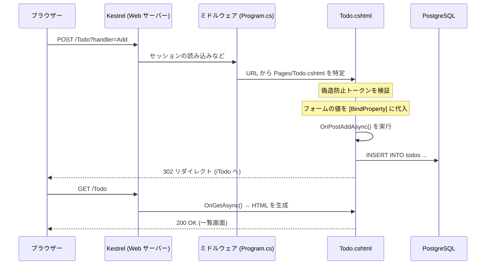

# Razor Pages とは ― Classic ASP 経験者のための入門

このリポジトリの `apps/web` は「ASP.NET Core Razor Pages」で書かれています。
名前が長くて分かりにくいので、Classic ASP を知っている人向けに順番に説明します。

## 1. ひとことで言うと

**Razor Pages は「1 ページ = 1 ファイル」で Web アプリを作る、ASP.NET Core 標準の仕組みです。**

- `Pages/Todo.cshtml` を置けば、それが `/Todo` という URL になります (ASP の `todo.asp` と同じ感覚)。
- HTML の中に `@` で C# を埋め込みます (ASP の `<% %>` にあたります)。
- Windows でも Linux でも macOS でも動き、Docker にそのまま載せられます。
- Microsoft が開発しているオープンソース (MIT ライセンス) で、無料で使えます。

Classic ASP のいちばん素直な後継は、実は ASP.NET Web Forms でも MVC でもなく、この Razor Pages です。

## 2. なぜ VBScript をそのまま動かさないのか

「昔の `.asp` を Docker で動かせないのか」という疑問に先に答えておきます。**動きません。**

- Classic ASP は Windows の Web サーバー (IIS) に組み込まれた機能で、Linux 版はありません。
- `.asp` の中身を実行する VBScript エンジンも Windows 専用です。
- `Server.CreateObject("ADODB.Connection")` や BASP21 のような部品は COM という Windows 固有の仕組みで動いています。

さらに、VBScript そのものが Windows で非推奨になりました。Microsoft は 2024 年 5 月に次の段階的な廃止計画を公表しています。

| 段階 | 時期 | 内容 |
|---|---|---|
| フェーズ 1 | Windows 11 バージョン 24H2 | VBScript は「オプション機能」になる。既定では有効 |
| フェーズ 2 | 2027 年ごろ | 既定で無効になる。必要なら手動で有効にする |
| フェーズ 3 | 時期未定 | Windows から削除される |

出典: [VBScript deprecation: Timelines and next steps (Windows IT Pro Blog)](https://techcommunity.microsoft.com/t5/windows-it-pro-blog/vbscript-deprecation-timelines-and-next-steps/ba-p/4148301)

Classic ASP 自体は現在も IIS の一機能として Windows に同梱されていますが、
土台の VBScript がこの状況なので、「いずれ書き直す」ことは避けられません。
最新の状況は必ず Microsoft の公式情報で確認してください。

そこでこのリポジトリでは、VBScript を無理に動かすのではなく、
**ASP の書き味をできるだけ残したまま C# に書き直す**という方法をとっています。
VBScript と C# は別の言語ですが、後述の対応表のとおり、考え方はほぼ 1 対 1 で置き換えられます。

## 3. 名前の整理 ― ASP と付くものが多すぎる問題

| 名前 | 登場 | 動く場所 | 特徴 | 現在 |
|---|---|---|---|---|
| **ASP** (Classic ASP) | 1996 年 | Windows (IIS) | `.asp`。VBScript を `<% %>` で HTML に埋め込む | 新機能の追加なし |
| **ASP.NET Web Forms** | 2002 年 | Windows (IIS) | `.aspx`。ボタンやグリッドを画面に貼り付けて作る | .NET Framework 専用。新しい .NET には無い |
| **ASP.NET MVC** | 2009 年 | Windows (IIS) | Model / View / Controller の 3 つに分けて作る | .NET Framework 版は保守のみ |
| **ASP.NET Core** | 2016 年 | Windows / Linux / macOS | 全面的に作り直された土台。以下の 3 つはこの上に載る | 現行 |
| └ **MVC** | | | 3 つに分ける方式の Core 版 | 現行 |
| └ **Razor Pages** | 2017 年 | | 1 ページ 1 ファイル方式 (このリポジトリ) | 現行 |
| └ **Blazor** | 2018 年〜 | | 画面の動きも C# で書く (JavaScript の代わり) | 現行 |

**Razor** という言葉は「HTML に C# を埋め込む書き方 (構文)」の名前です。拡張子は `.cshtml`。
MVC でも Razor Pages でも Blazor でも、この同じ書き方を使います。

つまり「ASP.NET Core Razor Pages」は、

- **ASP.NET Core** … 土台 (Web サーバー機能、設定、ログなど)
- **Razor** … HTML に C# を埋め込む書き方
- **Pages** … 1 ページ 1 ファイルで作る方式

の 3 つを合わせた呼び名です。

## 4. Razor の書き方 ― `<% %>` が `@` になった

| やりたいこと | Classic ASP | Razor |
|---|---|---|
| 値を出力 | `<%= Server.HTMLEncode(name) %>` | `@name` |
| 式を出力 | `<%= price * 1.1 %>` | `@(price * 1.1)` |
| コードを書く | `<% Dim x : x = 1 %>` | `@{ var x = 1; }` |
| 条件分岐 | `<% If n > 0 Then %> … <% End If %>` | `@if (n > 0) { … }` |
| 繰り返し | `<% Do Until rs.EOF %> … <% rs.MoveNext : Loop %>` | `@foreach (var row in rows) { … }` |
| コメント | `<% ' コメント %>` | `@* コメント *@` |
| HTML をそのまま出力 | `<%= html %>` | `@Html.Raw(html)` |

大事な違いが 1 つあります。**Razor の `@値` は、何もしなくても HTML エスケープされます。**

ASP では `<%= rs("title") %>` と書くとデータがそのまま出力され、
`<script>` を含むデータがあればそれが実行されてしまいました (クロスサイトスクリプティング)。
対策は `Server.HTMLEncode` を「全部の場所で忘れずに」書くことでした。
Razor は逆で、何も考えずに書けば安全、あえて生の HTML を出したいときだけ `@Html.Raw` と書きます。

`@` の後ろがどこまで C# なのかは Razor が自動で判断します。
`@name さん` の「さん」は HTML、`@(a + b)` のように式を書きたいときは丸かっこで囲みます。
メールアドレスの `info@example.com` は C# と誤解されません。`@` そのものを出したいときは `@@` です。

## 5. Razor Pages の仕組み

### 5.1 ファイルの場所がそのまま URL になる

```
apps/web/Pages/
├── Index.cshtml              →  /
├── Todo.cshtml               →  /Todo
└── Employees/
    ├── Index.cshtml          →  /Employees
    └── Edit.cshtml           →  /Employees/Edit  と  /Employees/Edit/123
```

ファイルの 1 行目に `@page` と書いたものだけがページになります。
`@page "{id:int?}"` と書くと、URL の末尾の数字を `id` として受け取れます
(ASP の `employee_edit.asp?id=123` が `/Employees/Edit/123` になります)。

`_` で始まるファイルはページではなく、共通部品です。

| ファイル | 役割 | ASP でいうと |
|---|---|---|
| `Shared/_Layout.cshtml` | 全ページ共通の枠 (ヘッダー・フッター) | `<!--#include file="header.asp"-->` |
| `_ViewStart.cshtml` | 「どの枠を使うか」の既定値 | 全ページ先頭に書いていた共通 include |
| `_ViewImports.cshtml` | 全ページ共通の `@using` など | 同上 |

### 5.2 「ハンドラー」が GET と POST を受け取る

ASP では 1 つの `.asp` の先頭で、こう振り分けていました。

```asp
<%
If Request.ServerVariables("REQUEST_METHOD") = "POST" Then
    Select Case Request.Form("action")
    Case "add"    : ' 追加の処理
    Case "delete" : ' 削除の処理
    End Select
End If
%>
```

Razor Pages では、この振り分けを決まった名前のメソッドに書きます。これを**ハンドラー**と呼びます。

| リクエスト | 呼ばれるメソッド |
|---|---|
| `GET /Todo` | `OnGet` (または `OnGetAsync`) |
| `POST /Todo` | `OnPost` (または `OnPostAsync`) |
| `POST /Todo?handler=Add` | `OnPostAdd` (または `OnPostAddAsync`) |
| `POST /Todo?handler=Delete&id=5` | `OnPostDelete(int id)` |

フォーム側は `<form method="post" asp-page-handler="Add">` と書くだけで、`?handler=Add` 付きの送信先になります。
`If` と `Select Case` の振り分けを自分で書く必要がありません。

`Async` が付くのは、DB アクセスのような「待ち時間のある処理」を効率よく扱うための書き方です。
メソッドの中で `await` を使うときは `Async` 付きにする、と覚えておけば十分です。

### 5.3 フォームの値は自動でプロパティに入る (モデルバインディング)

```csharp
[BindProperty]
public string? NewTitle { get; set; }
```

と書いておくと、`<input name="NewTitle">` の値が自動で入ります。
ASP の `Request.Form("NewTitle")` を 1 項目ずつ変数に移す作業がなくなります。
数値や日付への変換 (`CLng`、`CDate`) も自動で、変換できなければエラーとして記録されます。

URL の `?show=open` を受け取りたいときは `[BindProperty(SupportsGet = true)]` と書きます。

`[BindProperty]` を付けていないプロパティには、外から値が入りません。
「更新者」のように利用者に書き換えさせたくない項目を、うっかり受け取ってしまう事故を防げます。

### 5.4 入力チェックは「宣言」する

```csharp
[Display(Name = "氏名")]
[Required(ErrorMessage = "{0}は必須です。")]
[StringLength(50, ErrorMessage = "{0}は{1}文字以内で入力してください。")]
public string Name { get; set; } = "";
```

ASP で `If Len(name) = 0 Then errors = errors & "..."` と並べていたチェックを、項目の上に属性として書きます。
ハンドラーでは `if (!ModelState.IsValid) return Page();` の 1 行で「エラーがあれば同じ画面を出し直す」ができます。
DB を見ないと分からないチェック (社員番号の重複など) は `ModelState.AddModelError(...)` で足します。

実例は `Pages/Employees/Edit.cshtml.cs` の `EmployeeInput` クラスです。

### 5.5 タグヘルパー ― HTML の属性として書ける便利機能

`asp-` で始まる属性は、サーバー側で普通の HTML に変換されます。

| 書いたもの | 出力される HTML |
|---|---|
| `<a asp-page="/Employees/Edit" asp-route-id="5">` | `<a href="/Employees/Edit/5">` |
| `<form method="post" asp-page-handler="Add">` | `<form method="post" action="/Todo?handler=Add">` + 偽造防止トークン |
| `<input asp-for="Input.Name">` | `name` `id` `value` と入力チェック用の属性が付いた `<input>` |
| `<span asp-validation-for="Input.Name">` | その項目のエラーメッセージ |
| `<link href="~/css/site.css" asp-append-version="true">` | ファイル内容に応じた `?v=...` 付きの URL (キャッシュ対策) |

見た目は HTML のままなので、デザイナーが触っても壊れにくいのが利点です。
使わずに `<input name="NewTitle" value="@NewTitle">` と素の HTML で書いても動きます (`Todo.cshtml` はあえてそうしています)。

### 5.6 最初から入っている安全装置

| 脅威 | Classic ASP | Razor Pages |
|---|---|---|
| XSS (画面への埋め込み) | `Server.HTMLEncode` を毎回手書き | `@値` が自動でエスケープ |
| CSRF (なりすまし送信) | 自前で実装 (多くは未対策) | `<form method="post">` に自動でトークンが入り、検証される |
| SQL インジェクション | 文字列連結 + `Replace(s, "'", "''")` | `@パラメータ` で値を渡す |
| 過剰な値の受け取り | `Request.Form` は何でも読める | `[BindProperty]` を付けた項目だけ |
| エラー詳細の露出 | 設定次第で SQL やパスが画面に出る | 本番環境では既定でエラー画面に差し替え |

### 5.7 部品は「登録しておいて、受け取る」(依存性の注入)

ASP では必要になるたびに `Server.CreateObject("ADODB.Connection")` で部品を作っていました。
ASP.NET Core では、`Program.cs` で一度登録しておき、使う側は「これが欲しい」と宣言するだけです。

```csharp
// Program.cs (登録)
builder.Services.AddScoped<EmployeeRepository>();
```

```csharp
// ページ側 (受け取る)。コンストラクターの引数に書くと、自動で渡される
public class IndexModel(EmployeeRepository repository) : PageModel
```

`.cshtml` の中で受け取りたいときは `@inject NpgsqlDataSource Db` と書きます。

## 6. 2 つの書き方

Razor Pages には書き方が 2 つあり、このリポジトリでは両方を使い分けています。

### A. 1 ファイル完結スタイル ― ASP にいちばん近い

画面 (HTML) と処理 (`@functions { }`) を 1 つの `.cshtml` に書きます。

```cshtml
@page
@inject NpgsqlDataSource Db

<h1>ToDo</h1>
@foreach (var todo in Todos)
{
    <p>@todo.Title</p>
}

@functions {
    public List<Todo> Todos { get; private set; } = [];

    public async Task OnGetAsync()
    {
        await using var conn = await Db.OpenConnectionAsync();
        Todos = (await conn.QueryAsync<Todo>("SELECT id, title FROM todos ORDER BY id")).AsList();
    }
}
```

- 使っている場所: `Pages/Index.cshtml`、`Pages/Todo.cshtml`
- 向いている場面: 小さな画面、ASP からの移行の第一歩、ブログやスライドに載せるサンプル
- 弱点: 処理が長くなると読みにくい。処理だけを取り出してテストしにくい

### B. PageModel 分離スタイル ― 標準の書き方

画面を `Xxx.cshtml`、処理を `Xxx.cshtml.cs` の 2 ファイルに分けます。
処理側のクラスを **PageModel** と呼び、画面からは `@Model.プロパティ名` で参照します。

```
Pages/Employees/Index.cshtml      ← 画面。1 行目付近に @model IndexModel
Pages/Employees/Index.cshtml.cs   ← 処理。class IndexModel : PageModel
```

- 使っている場所: `Pages/Employees/` 以下
- 向いている場面: 検索・ページ送り・入力チェックなど、処理が多い画面
- Visual Studio や `dotnet new page` で作ると、この形になります

**どちらで書いても、動きも性能も同じです。** 小さく始めて、大きくなったら B に分ける、で構いません。

## 7. リクエストが処理される流れ

`POST /Todo?handler=Add` を例にすると、次の順に進みます。



- **Kestrel** は ASP.NET Core に内蔵された Web サーバーです。IIS が無くても、アプリ単体で HTTP を受けられます。
  Docker でそのまま動くのはこのためです。
- **ミドルウェア**は、リクエストが必ず通る共通処理です。`Program.cs` の `app.UseSession()` などがそれで、書いた順に実行されます。
- 登録や削除のあとに**リダイレクトする**のは、F5 (再読み込み) で同じ登録が二重に送られるのを防ぐためです
  (Post-Redirect-Get と呼ばれる定番の手法で、ASP の `Response.Redirect` と同じ考え方です)。
- リダイレクト先で「登録しました」と 1 回だけ表示するには `TempData["Message"]` を使います。

## 8. MVC や Blazor とはどう使い分けるか

| | Razor Pages | MVC | Blazor |
|---|---|---|---|
| 考え方 | ページ単位 | Controller と View を分ける | 画面部品 (コンポーネント) 単位 |
| 向いているもの | 一覧・登録・修正が中心の業務画面 | 1 つの処理から複数の画面や API を出し分けるもの | 入力に即座に反応する、動きの多い画面 |
| Classic ASP からの距離 | 近い | やや遠い | 遠い |

Microsoft の公式ドキュメントも、ページ中心の画面には Razor Pages を勧めています。
同じアプリの中で Razor Pages と MVC や Web API を混在させることもできるので、
「まず Razor Pages で移行し、必要になった部分だけ別の方式を足す」という進め方ができます。

## 9. つまずきやすい点

- **日本語が `&#x3042;` のような文字に化ける (HTML ソース上)。**
  表示は正常ですが、既定では英数字以外がすべて数値文字参照に変換されます。
  `Program.cs` の `AddWebEncoders(... UnicodeRanges.All ...)` でそのまま出力するようにしています。
- **Shift_JIS が使えない。**
  Linux の .NET は既定で Shift_JIS を持っていません。
  `Program.cs` の先頭で `Encoding.RegisterProvider(CodePagesEncodingProvider.Instance)` を呼ぶと使えるようになります。
  画面は UTF-8 のまま、Excel 向けの CSV だけ Shift_JIS にしています (`Csv.cs`)。
- **POST すると 400 Bad Request になる。**
  偽造防止トークンが送られていません。`<form method="post">` をタグヘルパーが有効な `.cshtml` の中に書いていれば自動で入ります。
  JavaScript から送信する場合は、トークンを自分でヘッダーかフォームに付ける必要があります。
- **値が入らない。**
  `[BindProperty]` の付け忘れか、`<input name="...">` とプロパティ名の不一致です。
  GET で受け取りたい場合は `SupportsGet = true` が必要です。
- **リンクやフォームの送信先から値が抜け落ちる。**
  1 つのタグに `asp-all-route-data` (まとめて指定) と `asp-route-id` (個別に指定) を両方書くと、個別指定の側が URL に出力されません。
  このリポジトリの削除フォームでは、対象の id を hidden 項目で送っています (`Employees/Index.cshtml`)。
- **`string` のプロパティが「必須です」というエラーになる。**
  `string` (null 不可) と宣言した項目は、自動的に必須入力として扱われます。
  省略できる項目は `string?` と宣言します。
- **Session が使えない。**
  `Program.cs` で `AddSession()` と `app.UseSession()` の両方が必要です。
  既定ではメモリ上に保存されるので、アプリを再起動すると消えます (ASP と同じです)。
  複数台構成にする場合は Redis などの共有ストアに切り替えます。
- **コンテナを作り直すとログイン状態やフォームが無効になる。**
  Cookie の暗号鍵がコンテナ内に保存されているためです。
  `docker-compose.yml` では鍵の保存先 (`/keys`) をボリュームにして、作り直しても引き継がれるようにしています。
- **時刻がずれる。**
  コンテナの既定のタイムゾーンは UTC です。`TZ=Asia/Tokyo` を指定しています。

## 10. 参考リンク

- [Razor Pages の概要 (Microsoft Learn)](https://learn.microsoft.com/ja-jp/aspnet/core/razor-pages/)
- [Razor 構文リファレンス (Microsoft Learn)](https://learn.microsoft.com/ja-jp/aspnet/core/mvc/views/razor)
- [VBScript deprecation: Timelines and next steps (Windows IT Pro Blog)](https://techcommunity.microsoft.com/t5/windows-it-pro-blog/vbscript-deprecation-timelines-and-next-steps/ba-p/4148301)
- 書き換えの早見表: [asp-to-razor-cheatsheet.md](asp-to-razor-cheatsheet.md)
